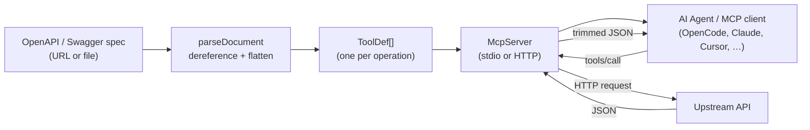
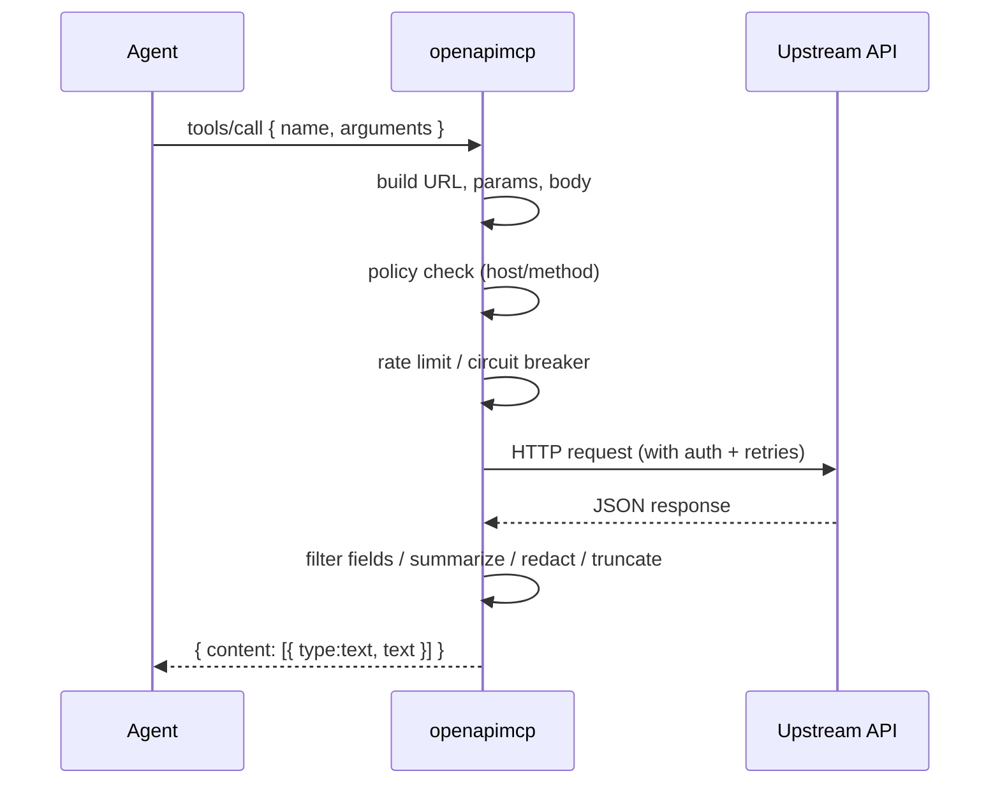
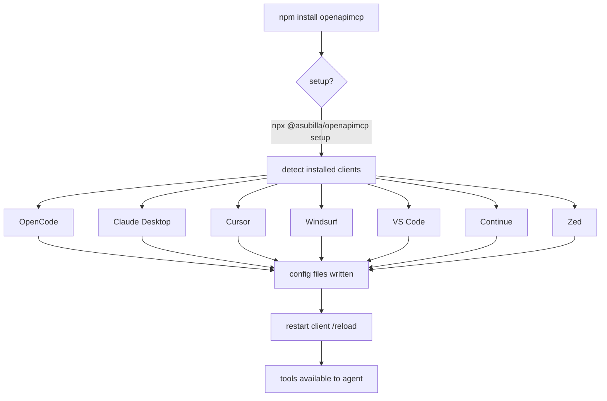

# openapimcp ⚡

> Turn any OpenAPI/Swagger spec into an MCP server — one command.

[](https://www.npmjs.com/package/openapimcp)
[](./LICENSE)
[](https://nodejs.org)
[](https://github.com/asubilla/OpenApiMCP)

```bash
npx @asubilla/openapimcp https://petstore3.swagger.io/api/v3/openapi.json
```

That's it. Your agent now has hands on that API.

<!-- TODO: replace with actual recording -->
<!--  -->

---

## For AI agents (LLMs / MCP clients)

If you are an AI agent reading this, here is the machine-usable summary:

- **What:** `openapimcp` is a CLI + library that converts an OpenAPI 3.x / Swagger 2.0 spec into a fully working MCP server (stdio or Streamable HTTP).
- **Install:** `npm install -g @asubilla/openapimcp` or `npx @asubilla/openapimcp <spec>`.
- **One-shot:** `npx @asubilla/openapimcp <spec-url-or-file>` starts a stdio MCP server with one tool per operation.
- **Auto-config:** `npx @asubilla/openapimcp setup <spec>` writes MCP entries into every detected client (OpenCode, Claude Desktop, Cursor, Windsurf, VS Code, Continue, Zed) on Windows/macOS/Linux.
- **HTTP gateway:** `openapimcp <spec> --http --port 3000` exposes `POST /mcp` (Streamable HTTP, stateless) + a developer portal at `/`.
- **Tool names:** `<operationId>` (sanitized). Multi-spec: `<slug>_<operationId>`.
- **Auth:** env vars `OPENAPIMCP_<SCHEME>` (bearer/basic/apiKey/oauth2/openIdConnect); `{env:NAME}` substitution anywhere.
- **Policy:** JSON file with `allow`/`deny` (globs), `methods`, `hosts`.
- **Returns:** pretty JSON + `HTTP <status>`, truncated to `--max-bytes` (default 20000), field-filterable via `--fields`.
- **No AI required for terminal use:** `openapimcp call <spec> <tool> --arg key=value` or `openapimcp run <spec> "<task>"`.

### Minimal agent config (OpenCode)
```json
{ "mcp": { "servers": { "myapi": { "type": "local", "command": ["npx", "-y", "@asubilla/openapimcp", "https://example.com/openapi.json"] } } } }
```

### Minimal agent config (Claude Desktop / Cursor)
```json
{ "mcpServers": { "myapi": { "command": "npx", "args": ["-y", "@asubilla/openapimcp", "https://example.com/openapi.json"] } } }
```

---

## Architecture



## Request flow



## Install flow



---

## "Why not just ask an AI to write it?"

| One-off prompt / ad-hoc curl | openapimcp |
| --- | --- |
| Code you must **maintain**; breaks when the spec changes | Nothing to maintain — re-run and it's in sync |
| LLMs **hallucinate** endpoints, params, encodings | Built **deterministically** from the spec |
| Burns tokens **every session** re-figuring out the API | Configured once; available to every session, agent, and teammate |
| Chokes on **large specs** (1000+ endpoints) | `--tool-search` progressive disclosure + `--tag`/`--read-only` |
| Dumps a 2 MB JSON blob into your context | `--fields`, `--summarize`, `--max-bytes`, `--redact` |

Ad-hoc is fine for a one-off. `openapimcp` is a **permanent capability**.

## Highlights

- 🔌 **Zero code** — runtime-generated tools, nothing to maintain
- 🔐 **Auto auth** — resolves `securitySchemes` from env vars; policy engine for tools/methods/hosts
- 🪶 **Context-friendly** — field allowlists, response summarization, redaction
- ♻️ **Resilient** — retries, caching (memory + disk), pagination, rate limiting, circuit breaker
- 🔎 **Progressive tool search** — `search_tools` + `call_tool` for huge APIs
- 🌐 **HTTP gateway** — Streamable HTTP with Host/Origin guards for teams + developer portal
- 📈 **Observability** — OpenTelemetry, Prometheus metrics, health probe, JSON logs, audit log
- 📦 **Extras** — `generate`, TS client generation, spec diff, smoke tests, Postman import, shell completions, TUI, auto-config
- 🐳 **Docker + Helm + Action + Homebrew + Scoop**

## Install

```bash
npx @asubilla/openapimcp <spec>          # no install needed
npm install -g @asubilla/openapimcp      # or globally
```

Requires **Node.js 20+**.

## Quickstart

```bash
openapimcp ui ./openapi.json                     # browse tools in the terminal
openapimcp list ./openapi.json                   # list tools
openapimcp doctor ./openapi.json                 # validate spec, auth, connectivity
openapimcp call ./openapi.json findPetsByStatus --args '{"status":"available"}'
openapimcp ./openapi.json                        # run as a stdio MCP server
openapimcp ./openapi.json --http                 # ...or as an HTTP gateway
```

## Auto-configure your editors

One command detects and configures every MCP client installed on your machine
(OpenCode, Claude Desktop, Cursor, Windsurf, VS Code, Continue, Zed) on
Windows, macOS, and Linux:

```bash
openapimcp setup ./openapi.json          # user-level clients by default
openapimcp setup ./openapi.json --project # project-level only
openapimcp setup ./openapi.json --dry-run # preview without writing
```

On `npm install`, openapimcp prints a hint; set `OPENAPIMCP_AUTO_SETUP=1` to run setup automatically.

## Provider setup

**OpenCode** (`opencode.json`):

```json
{
  "$schema": "https://opencode.ai/config.json",
  "mcp": {
    "servers": {
      "demo": { "type": "local", "command": ["npx", "-y", "@asubilla/openapimcp", "https://petstore3.swagger.io/api/v3/openapi.json"] }
    }
  }
}
```

**Claude Desktop / Cursor** (`mcpServers`):

```json
{ "mcpServers": { "demo": { "command": "npx", "args": ["-y", "@asubilla/openapimcp", "https://petstore3.swagger.io/api/v3/openapi.json"] } } }
```

**Remote HTTP gateway** (point any client at the URL):

```json
{ "mcpServers": { "demo": { "url": "http://127.0.0.1:3000/mcp" } } }
```

## Developer portal

When you run the HTTP gateway, open the root URL in a browser for a
self-contained **"Try it"** playground — no client needed:

```bash
openapimcp ./openapi.json --http --port 3000
# open http://127.0.0.1:3000/  -> lists every tool, lets you run them
```

The portal fetches `tools/list` from the MCP endpoint and renders a form per tool. Results are pretty-printed JSON. Also available at `/portal`, `/healthz`, `/metrics`.

## MCP prompts

Each operation is also exposed as an MCP **prompt** (`<tool>_help`) so agents
can ask "how do I use this?" and get a parameter summary. Prompts carry the
same descriptions, which now include any `example`/`examples` from the spec.

## Commands

```
openapimcp [specs...] [options]      # same as `serve` (default command)
openapimcp serve [specs...]          # stdio server, or --http gateway
openapimcp list [specs...]           # list tools (--json)
openapimcp doctor [specs...]         # validate spec, auth, connectivity
openapimcp call [spec] <tool>        # call one tool from the terminal
openapimcp ui <spec> [--tool NAME]   # browse tools in the terminal
openapimcp run <spec> "<task>"       # run a task by matching tool names (no AI)
openapimcp diff <old> <new>          # breaking / non-breaking changes
openapimcp generate <specs...> -o .  # emit a standalone project
openapimcp client <spec> -o ./client # generate a typed TypeScript client
openapimcp smoke <spec> [--out f]    # generate a node:test smoke suite
openapimcp postman <collection>      # list operations in a Postman collection
openapimcp init <spec>              # write an MCP client config entry
openapimcp use <spec>               # save a default spec
openapimcp setup [spec]             # auto-configure ALL detected editors
openapimcp completions [shell]       # bash | zsh | fish | powershell
```

### Common options

`--include` `--exclude` `--tag` `--read-only` `--policy` `--base-url` `-H/--header`
`--fields` `--max-bytes` `--timeout` `--retries` `--cache-ttl` `--cache-dir`
`--paginate` `--max-pages` `--rate-limit` `--breaker` `--redact` `--summarize`
`--config` `--dotenv` `--overlay` `--audit` `--log-json` `--tool-search` `--arg`
`--print-config`

Gateway: `--http` `--port` `--host` `--path` `--allowed-host` `--allowed-origin`.

## Auth from `securitySchemes`

`openapimcp` reads the spec's security schemes and looks for credentials in environment variables named `OPENAPIMCP_<SCHEME>`:

| Scheme | Env var | Example |
| --- | --- | --- |
| `http` bearer | `OPENAPIMCP_<SCHEME>` (or `OPENAPIMCP_TOKEN`) | `Authorization: Bearer <value>` |
| `http` basic | `OPENAPIMCP_<SCHEME>_USERNAME` + `_PASSWORD` | base64-encoded |
| `apiKey` header / query / cookie | `OPENAPIMCP_<SCHEME>` | sent in the named slot |
| `oauth2` / `openIdConnect` | `OPENAPIMCP_<SCHEME>` (or `OPENAPIMCP_TOKEN`) | `Authorization: Bearer <value>` |

`{env:NAME}` is substituted anywhere you pass a value, e.g. `-H "Authorization: Bearer {env:MY_TOKEN}"`.

## Keep responses small

```bash
openapimcp call ./openapi.json findPetsByStatus --fields "id,name,status"
openapimcp ./openapi.json --max-bytes 4000 --summarize --redact
```

## Policy engine

```json
{
  "allow": ["get*", "find*"],
  "deny": ["delete*"],
  "methods": ["GET", "POST"],
  "hosts": ["api.example.com", "*.trusted.com"]
}
```

```bash
openapimcp ./openapi.json --http --read-only --policy ./policy.json
```

## Resilient by default

```bash
openapimcp ./openapi.json \
  --retries 3 --cache-ttl 60 --cache-dir .cache \
  --paginate --max-pages 10 \
  --rate-limit 10 --breaker
```

## Combine several APIs

```bash
openapimcp ./stripe.json ./github.json
# -> stripe_createCharge, github_getRepo, ...
```

## Generate a standalone project / client

```bash
openapimcp generate ./openapi.json --out ./my-mcp --read-only
cd my-mcp && npm install && npm start

openapimcp client ./openapi.json --out ./client   # typed TS fetch client
openapimcp smoke ./openapi.json --out ./smoke.test.ts
```

## Docker & Kubernetes

```bash
docker run -p 3000:3000 ghcr.io/asubilla/openapimcp \
  https://petstore3.swagger.io/api/v3/openapi.json \
  --http --host 0.0.0.0 --read-only

helm install demo ./charts/openapimcp --set spec=https://example.com/openapi.json
```

## GitHub Action

```yaml
- uses: asubilla/OpenApiMCP@main
  with:
    spec: ./openapi.json
    command: doctor
```

## Use as a library

```ts
import { parseSpec, buildServer, startGateway, rankTools, redact, summarizeJson, portalHtml } from "openapimcp";

const api = await parseSpec("https://example.com/openapi.json");
await startGateway({ port: 3000, host: "127.0.0.1", path: "/mcp", createServer: () => buildServer(api, { headers: {}, timeoutMs: 30000, maxBytes: 20000, retries: 2 }) });
```

## How it works

1. **Parse** — loads and `$ref`-dereferences the spec (OpenAPI 3.x or Swagger 2.0).
2. **Flatten** — each `path` + `method` becomes a tool; params, JSON body, tags, auth, annotations, examples, and base URL are derived from the spec.
3. **Serve** — tools are registered on an MCP server over stdio or Streamable HTTP; calls run through the policy engine, rate limiter, circuit breaker, cache, telemetry and audit log.

JSON Schema → Zod conversion is done in-house, so there are no heavyweight codegen dependencies.

## Roadmap

- [x] Auth presets, filtering, annotations, retries, caching, pagination, multi-spec, `generate`
- [x] HTTP gateway, policy engine, OpenTelemetry, Docker
- [x] Redaction, summarization, tool search, rate limit, circuit breaker, disk cache
- [x] Config file, `.env`, overlays, diff, TS client, smoke tests, Postman, completions, TUI, Helm, Action, auto-config
- [x] Developer portal, MCP prompts, few-shot examples
- [ ] OAuth2 client-credentials flow (auto token fetch + refresh)
- [ ] `structuredContent` output schemas
- [ ] GraphQL / gRPC → MCP

## Contributing

```bash
npm install
npm test   # build + 232 unit tests + end-to-end MCP handshake
```

## License

[MIT](./LICENSE)