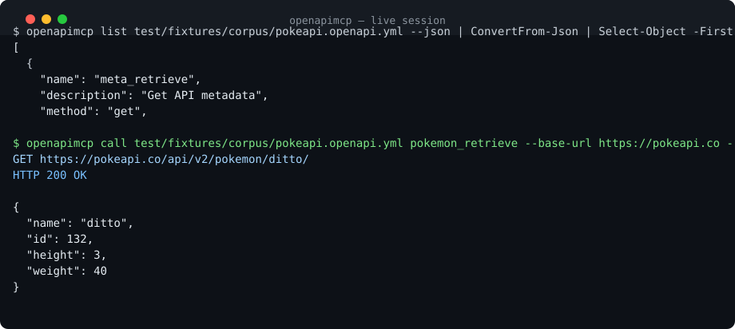
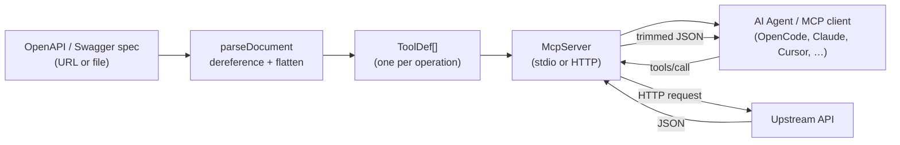
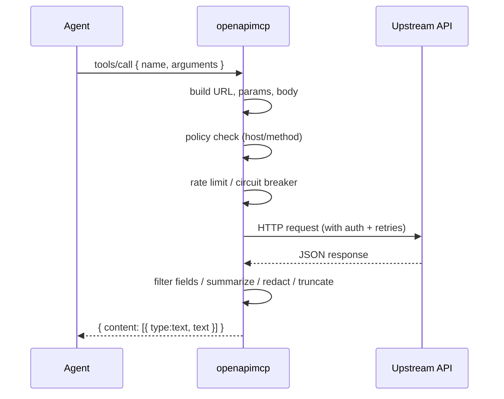
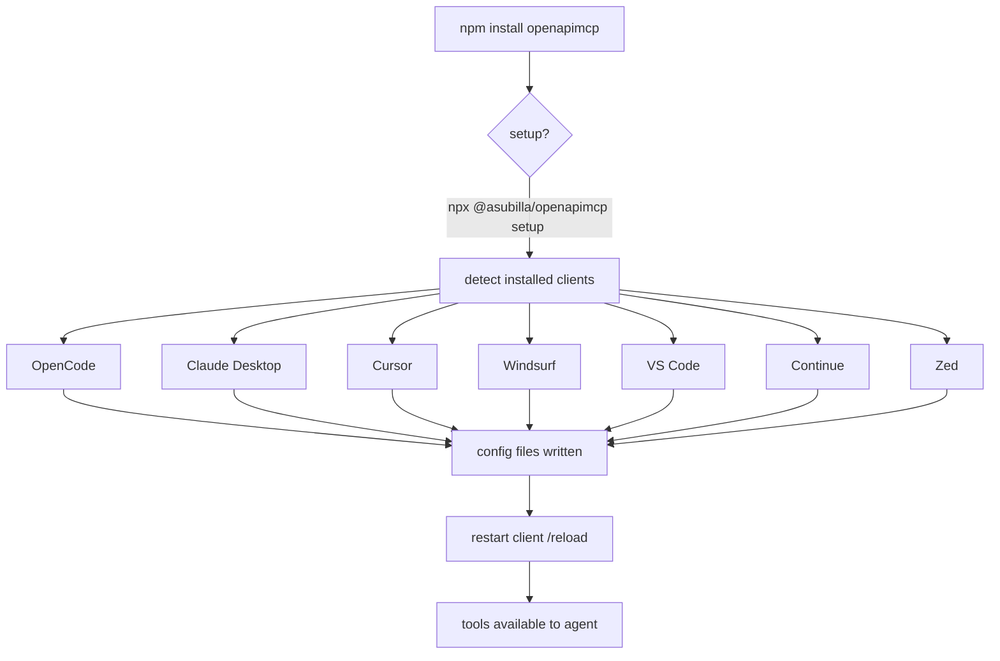

# openapimcp ⚡

> Turn any OpenAPI/Swagger spec into an MCP server — one command.

[](https://www.npmjs.com/package/@asubilla/openapimcp)
[](./LICENSE)
[](https://nodejs.org)
[](https://github.com/asubilla/OpenApiMCP)

```bash
npx @asubilla/openapimcp https://petstore3.swagger.io/api/v3/openapi.json
```

That's it. Your agent now has hands on that API.



---

## For AI agents (LLMs / MCP clients)

If you are an AI agent reading this, here is the machine-usable summary:

- **What:** `openapimcp` is a CLI + library that converts an OpenAPI 3.x / Swagger 2.0 spec into a fully working MCP server (stdio or Streamable HTTP).
- **Install:** `npm install -g @asubilla/openapimcp` or `npx @asubilla/openapimcp <spec>`.
- **One-shot:** `npx @asubilla/openapimcp <spec-url-or-file>` starts a stdio MCP server with one tool per operation.
- **Auto-config:** `npx @asubilla/openapimcp setup <spec>` writes MCP entries into every detected client (OpenCode, Claude Desktop, Cursor, Windsurf, VS Code, Continue, Zed) on Windows/macOS/Linux.
- **HTTP gateway:** `openapimcp <spec> --http --port 3000` exposes `POST /mcp` (Streamable HTTP, stateless) + a developer portal at `/`.
- **Tool names:** `<operationId>` (sanitized). Multi-spec: `<slug>_<operationId>`.
- **Auth:** env vars `OPENAPIMCP_<SCHEME>` (bearer/basic/apiKey/oauth2/openIdConnect); `{env:NAME}` substitution anywhere.
- **Policy:** JSON file with `allow`/`deny` (globs), `methods`, `hosts`.
- **Returns:** pretty JSON + `HTTP <status>`, truncated to `--max-bytes` (default 20000), field-filterable via `--fields`.
- **No AI required for terminal use:** `openapimcp call <spec> <tool> --arg key=value` or `openapimcp run <spec> "<task>"`.

### Minimal agent config (OpenCode)
```json
{ "mcp": { "servers": { "myapi": { "type": "local", "command": ["npx", "-y", "@asubilla/openapimcp", "https://example.com/openapi.json"] } } } }
```

### Minimal agent config (Claude Desktop / Cursor)
```json
{ "mcpServers": { "myapi": { "command": "npx", "args": ["-y", "@asubilla/openapimcp", "https://example.com/openapi.json"] } } }
```

---

## Architecture



## Request flow



## Install flow



---

## "Why not just ask an AI to write it?"

| One-off prompt / ad-hoc curl | openapimcp |
| --- | --- |
| Code you must **maintain**; breaks when the spec changes | Nothing to maintain — re-run and it's in sync |
| LLMs **hallucinate** endpoints, params, encodings | Built **deterministically** from the spec |
| Burns tokens **every session** re-figuring out the API | Configured once; available to every session, agent, and teammate |
| Chokes on **large specs** (1000+ endpoints) | `--tool-search` progressive disclosure + `--tag`/`--read-only` |
| Dumps a 2 MB JSON blob into your context | `--fields`, `--summarize`, `--max-bytes`, `--redact` |

Ad-hoc is fine for a one-off. `openapimcp` is a **permanent capability**.

## Highlights

- 🔌 **Zero code** — runtime-generated tools, nothing to maintain
- 🔐 **Auto auth** — resolves `securitySchemes` from env vars; policy engine for tools/methods/hosts
- 🪶 **Context-friendly** — field allowlists, response summarization, redaction, structuredContent
- ♻️ **Resilient** — retries, caching (memory + disk), pagination, rate limiting, circuit breaker
- 🔎 **Progressive tool search** — `search_tools` + `call_tool` for huge APIs
- ⏳ **Async jobs** — 202 Accepted polling, status-URL detection, timeout/retry
- 🌐 **HTTP gateway** — Streamable HTTP with Host/Origin guards for teams + developer portal
- 📈 **Observability** — OpenTelemetry, Prometheus metrics, health probe, JSON logs, audit log
- 📦 **Extras** — `generate`, TS client generation, spec diff, smoke tests, Postman import, shell completions, TUI, auto-config
- 📋 **`examples`** — paste-ready `opencode.json` / `claude_desktop_config.json` / `mcp.json` / `.windsurf/MCP_config.json` / `settings.json` / TOML snippets for every detected client
- 🎚️ **`output-schema`** — see which operations advertise a typed `outputSchema` right now
- 📡 **SSE resumability** — `--resumable` on the HTTP gateway: session IDs + `Last-Event-ID` replay for reconnecting clients
- 👤 **Per-user gateway quotas** — `--user-rate-limit '{"defaultPerMinute":60,"perUser":{"vip":120}}'`, keyed by `x-user-key` / `x-api-key` / auth tail
- 🎚️ **Typed tool outputs** — tools with clean 2xx response schemas now advertise `outputSchema` automatically (when `--structured-content` is on)
- 🧵 **Batch calls** — `openapimcp batch <spec> --file calls.json --concurrency 5` runs many tool calls concurrently with partial-failure reporting
- 🛡️ **Production guardrails** — non-loopback/no-auth/no-policy gateway checks, idempotency keys, SigV4 signing, tenant/user credential isolation, deprecated-op filtering, response normalization, budgets
- 🐳 **Docker + Helm + Action + Homebrew + Scoop**

## Install

### For AI agents (zero install)

```bash
npx -y @asubilla/openapimcp <spec>          # no install; MCP clients auto-detect or use `setup`
```

### For manual developers (global install)

```bash
npm install -g @asubilla/openapimcp
openapimcp --help
```

Requires **Node.js 20+**.

Want the full picture — install for both audiences, how to call every tool,
and honest roadmap? → [`docs/roadmap.md`](docs/roadmap.md). What gets inferred vs needs hints: [`docs/compat-openapimcp-vs-spec.md`](docs/compat-openapimcp-vs-spec.md).

## Quickstart

```bash
openapimcp ui ./openapi.json                     # browse tools in the terminal
openapimcp list ./openapi.json                   # list tools
openapimcp doctor ./openapi.json                 # validate spec, auth, connectivity
openapimcp call ./openapi.json findPetsByStatus --args '{"status":"available"}'
openapimcp ./openapi.json                        # run as a stdio MCP server
openapimcp ./openapi.json --http                 # ...or as an HTTP gateway
```

## Auto-configure your editors

One command detects and configures every MCP client installed on your machine:

```bash
openapimcp setup ./openapi.json          # user-level clients by default
openapimcp setup ./openapi.json --project # project-level only
openapimcp setup ./openapi.json --dry-run # preview without writing
```

On `npm install`, openapimcp prints a hint; set `OPENAPIMCP_AUTO_SETUP=1` to run setup automatically.

## Provider setup

**OpenCode** (`opencode.json`):

```json
{
  "$schema": "https://opencode.ai/config.json",
  "mcp": {
    "servers": {
      "demo": { "type": "local", "command": ["npx", "-y", "@asubilla/openapimcp", "https://petstore3.swagger.io/api/v3/openapi.json"] }
    }
  }
}
```

**Claude Desktop / Cursor** (`mcpServers`):

```json
{ "mcpServers": { "demo": { "command": "npx", "args": ["-y", "@asubilla/openapimcp", "https://petstore3.swagger.io/api/v3/openapi.json"] } } }
```

**Remote HTTP gateway** (point any client at the URL):

```json
{ "mcpServers": { "demo": { "url": "http://127.0.0.1:3000/mcp" } } }
```

## Developer portal

When you run the HTTP gateway, open the root URL in a browser for a
self-contained **"Try it"** playground — no client needed:

```bash
openapimcp ./openapi.json --http --port 3000
# open http://127.0.0.1:3000/  -> lists every tool, lets you run them
```

The portal fetches `tools/list` from the MCP endpoint and renders a form per tool. Results are pretty-printed JSON. Also available at `/portal`, `/healthz`, `/metrics`.

## MCP prompts

Each operation is also exposed as an MCP **prompt** (`<tool>_help`) so agents
can ask "how do I use this?" and get a parameter summary. Prompts carry the
same descriptions, which now include any `example`/`examples` from the spec.

## Compatibility report

`openapimcp compat <spec>` tells you which operations work out of the box —
before you wire an agent to your API:

- **supported** — no concerns.
- **partial** — works, with notes (e.g. `oneOf`/`allOf` schemas — passed through, just flagged).
- **unsupported** — cannot be faithfully called (e.g. XML / form-encoded / octet-stream bodies, callbacks, required header/cookie params, deprecated ops).

Real output — [Swagger Petstore](https://petstore3.swagger.io/api/v3/openapi.json) (OpenAPI 3.0.4):

```
openapimcp compatibility report
  supported:   13
  partial:     0
  unsupported: 6
  total:       19

✗ addPet (POST /pet) — non-JSON body: application/xml, non-JSON body: application/x-www-form-urlencoded
✓ getPetById (GET /pet/{petId})
✓ deletePet (DELETE /pet/{petId})
✗ uploadFile (POST /pet/{petId}/uploadImage) — non-JSON body: application/octet-stream
```

Real output — [PokeAPI](https://pokeapi.co) (OpenAPI **3.1.0**, YAML, cyclic `$ref`s):

```
  supported:   51
  partial:     51
  unsupported: 0
  total:       102

~ ability_retrieve (GET /api/v2/ability/{id}/) — exotic schema: allOf
```

Real output — [httpbin.org](https://httpbin.org) (**Swagger 2.0**):

```
  supported:   73
  partial:     0
  unsupported: 0
  total:       73
```

## Real-spec corpus tests

`compat` is only trustworthy if it survives real-world specs — including
self-referencing `$ref`s, YAML, Swagger 2.0 and non-JSON bodies. Three real
public specs are vendored into the repo as regression fixtures
(`test/fixtures/corpus/`), and `test/corpus.test.ts` runs against them
**offline** (no network needed):

| Spec | Format | Paths | Why it's in the corpus |
|---|---|---|---|
| [Swagger Petstore](https://petstore3.swagger.io/api/v3/openapi.json) | OpenAPI 3.0.4 | 13 (19 operations) | non-JSON bodies; pins the exact `compat` verdicts |
| [httpbin.org](https://httpbin.org/spec.json) | **Swagger 2.0** | 52 (73 operations) | legacy `securityDefinitions` path |
| [PokeAPI](https://raw.githubusercontent.com/PokeAPI/pokeapi/master/openapi.yml) | OpenAPI **3.1.0**, YAML | cyclic | self-referential schemas (evolution chains) that once crashed `compat`/`pin`/`lint`/`bundle` |

The corpus test asserts: each spec loads, tools are generated, and `compat`,
`lint`, `pin`, `bundle` all stay stable on the cyclic 2026-era PokeAPI graph.
Refreshing the snapshots and their licenses:
[`test/fixtures/corpus/README.md`](test/fixtures/corpus/README.md).

## Verified against real APIs (2026-11-16, v1.13.2)

Not every CLI claim is aspirational — here is what was actually run against
the live public internet, verbatim:

**Live MCP gateway on PokeAPI** (`openapimcp ./pokeapi.yml --http --port 3000
--gateway-key topsecret`):

```
GET /healthz           -> {"status":"ok","uptimeSeconds":2}
GET /metrics          -> openapimcp_gateway_info{version="1.13.2"} 1
POST /mcp (no key)    -> HTTP 401 Unauthorized
POST /mcp (+ X-API-Key) -> HTTP 200, SSE:
  data: {"result":{"protocolVersion":"2024-11-05",
         "serverInfo":{"name":"pok-api","version":"1.13.2"}}, ...}
```

**Live tool calls** (no mock, real network):

```
$ openapimcp ./pokeapi.yml pokemon_retrieve --base-url https://pokeapi.co \
    --arg id=ditto --fields name,id,height,weight,base_experience
GET https://pokeapi.co/api/v2/pokemon/ditto/
HTTP 200 OK
{ "name": "ditto", "id": 132, "height": 3, "weight": 40, "base_experience": 101 }
```

Batch 3-way concurrency against httpbin.org (all HTTP 200):

```
$ openapimcp batch ./httpbin.json --file calls.json --base-url https://httpbin.org --concurrency 3
✓ get__get
✓ get__uuid
✓ get__status_codes
3 ok, 0 failed, 3 total
```

`doctor` against both live specs (truncated):

```
httpbin.org  -> 73 tools, compat 73/0/0, reachable HTTP 200
pokeapi.yml  -> 102 tools, compat 51/51/0 (allOf/oneOf annotations)
petstore3    -> 19 tools, compat 13/0/6 (XML bodies)
```

Spec diff, pinned corpus snapshot vs live petstore3.swagger.io:

```
openapimcp diff ./fixtures/corpus/petstore3.openapi.json ./petstore3-live.json
breaking:     0
non-breaking: 0
```

Best-effort results worth knowing: `discover https://pokeapi.co` reports
"no OpenAPI spec found" (PokeAPI doesn't publish at well-known paths),
and `lint openapi.json` correctly flags httpbin.org's missing `info.version`
(1 error, 81 warnings) — the linter is honest, not vanity.

Interactive surfaces (`openapimcp ui`) are covered by unit tests but not part
of this sweep.

## Commands

```
openapimcp [specs...] [options]      # same as `serve` (default command)
openapimcp serve [specs...]          # stdio server, or --http gateway
openapimcp list [specs...]           # list tools (--json)
openapimcp doctor [specs...]         # validate spec, auth, connectivity
openapimcp call [spec] <tool>        # call one tool from the terminal
openapimcp ui <spec> [--tool NAME]   # browse tools in the terminal
openapimcp run <spec> "<task>"       # run a task by matching tool names (no AI)
openapimcp diff <old> <new>          # breaking / non-breaking changes
openapimcp generate <specs...> -o .  # emit a standalone project
openapimcp client <spec> -o ./client # generate a typed TypeScript client
openapimcp smoke <spec> [--out f]    # generate a node:test smoke suite
openapimcp postman <collection>      # list operations in a Postman collection
openapimcp discover <domain>         # auto-discover an OpenAPI spec from a domain
openapimcp lint <spec>              # lint a spec for quality issues
openapimcp compat <spec>            # report fully/partially/unsupported operations
openapimcp dry-run <spec> <tool>    # preview the exact request (secrets masked) without sending
openapimcp config <file>            # validate an openapimcp config file
openapimcp batch <spec> --file calls.json  # call many tools concurrently, partial-failure report
openapimcp history [--file f]       # show calls recorded via --history (JSON-lines)
openapimcp bundle <spec> [--out f]  # resolve external $refs into a self-contained spec
openapimcp pin <spec>               # record the sha256 hash of a spec (detect unexpected changes)
openapimcp presets                  # curated APIs: petstore, pokeapi, github (use with --preset)
openapimcp marketplace [query]       # browse 2000+ public APIs on APIs.guru
openapimcp examples [spec]          # paste-ready MCP client config snippets (OpenCode, Claude, Cursor, …)
openapimcp output-schema <spec>     # which ops carry a typed outputSchema
openapimcp init <spec>              # write an MCP client config entry
openapimcp use <spec>               # save a default spec
openapimcp setup [spec]             # auto-configure ALL detected editors
openapimcp completions [shell]       # bash | zsh | fish | powershell
```

### Common options

`--include` `--exclude` `--tag` `--read-only` `--policy` `--base-url` `-H/--header`
`--fields` `--max-bytes` `--timeout` `--retries` `--cache-ttl` `--cache-dir`
`--paginate` `--max-pages` `--rate-limit` `--breaker` `--redact` `--summarize`
`--config` `--dotenv` `--overlay` `--audit` `--log-json` `--tool-search` `--arg`
`--print-config` `--hide-deprecated` `--idempotency` `--budget` `--response-map`
`--history` `--plugin` `--sigv4` `--resources` `--preset` `--tenants` `--tenant` `--user-key`
`--ca <file>` `--proxy <url>`

Gateway: `--http` `--port` `--host` `--path` `--allowed-host` `--allowed-origin` `--resumable` `--user-rate-limit`.

## Production hardening

```bash
openapimcp serve api.json --http --host 127.0.0.1   # refuses to bind non-loopback without auth/policy (warns/errors)
openapimcp serve api.json --read-only               # drop all write operations
openapimcp serve api.json --hide-deprecated         # drop deprecated/sunset operations
openapimcp serve api.json --idempotency              # add Idempotency-Key to POST/PUT/PATCH/DELETE
openapimcp serve api.json --budget '{"maxCalls":100,"maxBytes":1000000}' --history calls.jsonl
openapimcp call api.json listPets --tenants tenants.json --tenant acme --user-key bob
openapimcp serve api.json --resources                # expose spec/operations/servers/security as MCP resources
openapimcp serve api.json --plugin ./my-auth.js      # hook beforeRequest/afterResponse
openapimcp serve api.json --sigv4 us-east-1:execute-api   # AWS SigV4 (env: AWS_ACCESS_KEY_ID/AWS_SECRET_ACCESS_KEY)
openapimcp serve api.json --resumable                   # SSE event ids + Last-Event-ID replay for reconnects
openapimcp serve api.json --user-rate-limit '{"defaultPerMinute":60,"perUser":{"vip":300}}'   # 429 on over-limit users
```

- **Tenant isolation** — `tenants.json` (`{"tenants": {...}}`) pins baseUrl, headers, policy and read-only per tenant, with per-user credential overrides (`users.<key>`). User creds win over tenant creds.
- **Plugins** — a plugin is a module exporting `hooks: [{ name, beforeRequest?, afterResponse? }]` (or a default-exported single hook). `beforeRequest(req)` may return headers to merge (use it for custom auth/signing); `afterResponse(req, res)` observes status/body.
- **Response normalization** — `--response-map '{"pick":["id"],"drop":["secret"],"rename":{"id":"userId"}}'` reshapes JSON responses for the model.
- **Corporate proxy / custom CA** — `--ca corp-root.pem --proxy http://proxy:3128` routes upstream calls through your proxy with your CA trusted (HTTPS is CONNECT-tunneled). Requires the optional `undici` package: `npm install undici`.
- **Production checks** — starting the HTTP gateway with a non-loopback host, no auth, or no read-only/policy logs `ERROR`/`WARN` records with fixes.

## Auth from `securitySchemes`

`openapimcp` reads the spec's security schemes and looks for credentials in environment variables named `OPENAPIMCP_<SCHEME>`:

| Scheme | Env var | Example |
| --- | --- | --- |
| `http` bearer | `OPENAPIMCP_<SCHEME>` (or `OPENAPIMCP_TOKEN`) | `Authorization: Bearer <value>` |
| `http` basic | `OPENAPIMCP_<SCHEME>_USERNAME` + `_PASSWORD` | base64-encoded |
| `apiKey` header / query / cookie | `OPENAPIMCP_<SCHEME>` | sent in the named slot |
| `oauth2` / `openIdConnect` | `OPENAPIMCP_<SCHEME>` (or `OPENAPIMCP_TOKEN`) | `Authorization: Bearer <value>` |

`{env:NAME}` is substituted anywhere you pass a value, e.g. `-H "Authorization: Bearer {env:MY_TOKEN}"`.

## Keep responses small

```bash
openapimcp call ./openapi.json findPetsByStatus --fields "id,name,status"
openapimcp ./openapi.json --max-bytes 4000 --summarize --redact
```

## Policy engine

```json
{
  "allow": ["get*", "find*"],
  "deny": ["delete*"],
  "methods": ["GET", "POST"],
  "hosts": ["api.example.com", "*.trusted.com"]
}
```

```bash
openapimcp ./openapi.json --http --read-only --policy ./policy.json
```

## Resilient by default

```bash
openapimcp ./openapi.json \
  --retries 3 --cache-ttl 60 --cache-dir .cache \
  --paginate --max-pages 10 \
  --rate-limit 10 --breaker
```

## Combine several APIs

```bash
openapimcp ./stripe.json ./github.json
# -> stripe_createCharge, github_getRepo, ...
```

## Generate a standalone project / client

```bash
openapimcp generate ./openapi.json --out ./my-mcp --read-only
cd my-mcp && npm install && npm start

openapimcp client ./openapi.json --out ./client   # typed TS fetch client
openapimcp smoke ./openapi.json --out ./smoke.test.ts
```

## Production deployment

See [docs/production.md](docs/production.md) — Docker Compose, nginx + TLS, secrets,
CI examples, policy baseline, and monitoring.

## Docker & Kubernetes

```bash
docker run -p 3000:3000 ghcr.io/asubilla/openapimcp \
  https://petstore3.swagger.io/api/v3/openapi.json \
  --http --host 0.0.0.0 --read-only

helm install demo ./charts/openapimcp --set spec=https://example.com/openapi.json
```

## GitHub Action

```yaml
- uses: asubilla/OpenApiMCP@main
  with:
    spec: ./openapi.json
    command: doctor
```

## Use as a library

```ts
import { parseSpec, buildServer, startGateway, rankTools, redact, summarizeJson, portalHtml } from "@asubilla/openapimcp";

const api = await parseSpec("https://example.com/openapi.json");
await startGateway({ port: 3000, host: "127.0.0.1", path: "/mcp", createServer: () => buildServer(api, { headers: {}, timeoutMs: 30000, maxBytes: 20000, retries: 2 }) });
```

## How it works

1. **Parse** — loads and `$ref`-dereferences the spec (OpenAPI 3.x or Swagger 2.0).
2. **Flatten** — each `path` + `method` becomes a tool; params, JSON body, tags, auth, annotations, examples, and base URL are derived from the spec.
3. **Serve** — tools are registered on an MCP server over stdio or Streamable HTTP; calls run through the policy engine, rate limiter, circuit breaker, cache, telemetry and audit log.

JSON Schema → Zod conversion is done in-house, so there are no heavyweight codegen dependencies.

## Roadmap

Full roadmap with install + usage for both audiences and per-command
`[verified] / [unverified]` markers: **[docs/roadmap.md](docs/roadmap.md)**.

- [x] Auth presets, filtering, annotations, retries, caching, pagination, multi-spec, `generate`
- [x] HTTP gateway, policy engine, OpenTelemetry, Docker
- [x] Redaction, summarization, tool search, rate limit, circuit breaker, disk cache
- [x] Config file, `.env`, overlays, diff, TS client, smoke tests, Postman, completions, TUI, Helm, Action, auto-config
- [x] Developer portal, MCP prompts, MCP resources (`--resources`), few-shot examples
- [x] Gateway auth (API key + JWT), OAuth2 client-credentials, spec discovery, cost tracking
- [x] Context budget, feedback store, eval harness, agent memory, workflow, lint, sampling, marketplace
- [x] `structuredContent` output (1.7.2), GraphQL → MCP, serverless adapters
- [ ] gRPC → MCP
- [ ] MCP streaming resumption (last-event-id)
- [ ] Per-user rate limits at the gateway

See [docs/roadmap.md](docs/roadmap.md) for the per-audience breakdown.

## Contributing

```bash
npm install
npm test   # build + 795 unit tests + end-to-end MCP handshake
```

## License

[MIT](./LICENSE)